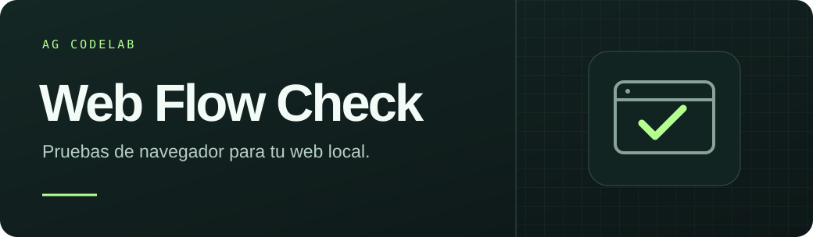
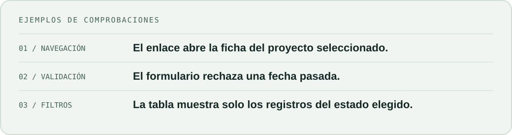

Describe un flujo de tu web local. Tu agente crea una prueba, la ejecuta en Chromium y te deja el archivo para repetirla cuando cambie tu código.

## Instala la skill

Con **Node.js 22 o superior** y **Git**, ejecuta este comando en una terminal:

```sh
npx --yes github:Angel-ETECH/Web-Flow-Check-v0.1.0 skill codex
```

Para **Antigravity**, cambia `codex` por `antigravity`. La instalación es personal y queda disponible en tus proyectos. Si la skill no aparece, abre una sesión nueva en tu agente.

## Pruébala en tu web

Arranca tu web local y abre el proyecto en tu agente. Invoca **`$web-flow-check`** en Codex o **`/web-flow-check`** en Antigravity.

> En http://localhost:8000/tienda, agrega dos cuadernos de S/ 30 y comprueba que el subtotal sea S/ 60. Deja una prueba que pueda repetir.

En la primera ejecución, el runner descarga Playwright y Chromium si hacen falta. Después puedes repetir la prueba localmente. El agente indica qué comprobó y dónde dejó la prueba y el reporte HTML.



<details>
<summary>Demo y uso desde la terminal</summary>

En una copia descargada del repositorio, ejecuta `npm run demo`. Verifica un portafolio y una tienda con datos de ejemplo. Ejecuta `npm run demo -- --broken` para provocar dos fallos y `npm run report` para abrir el último reporte.

Para tu web, adapta el [ejemplo](examples/local-page.spec.mjs), guárdalo en `checks/inicio.spec.mjs` y ejecuta:

```sh
npm run check -- http://localhost:8000 inicio.spec.mjs
```

La demo usa el puerto 4176. En Linux, Chromium puede necesitar [dependencias del sistema](https://playwright.dev/docs/browsers#install-system-dependencies). Si PowerShell bloquea los scripts, usa `npx.cmd` y `npm.cmd`.

</details>

<details>
<summary>Instalación desde una copia local y otros agentes</summary>

Si ya descargaste el código, ejecuta `npm run install:skill -- codex` o cambia el destino por `antigravity`. El instalador también reconoce la ruta de Claude Code con `claude-code`.

Para otro cliente compatible con Agent Skills, ejecuta `npm run init -- RUTA_DE_SKILLS/web-flow-check` con la ruta que indique su documentación. Para actualizar una copia personal instalada con el comando de arriba, mueve la carpeta anterior y vuelve a ejecutar el instalador. Los specs generados se guardan en el proyecto que estás probando.

</details>

Las pruebas y el reporte se guardan localmente. Para generar pruebas con un agente, se aplica la configuración de conexión y privacidad de ese cliente. Usa cuentas y datos de prueba para flujos que escriben datos.

**AG CodeLab** · [Licencia MIT](LICENSE)