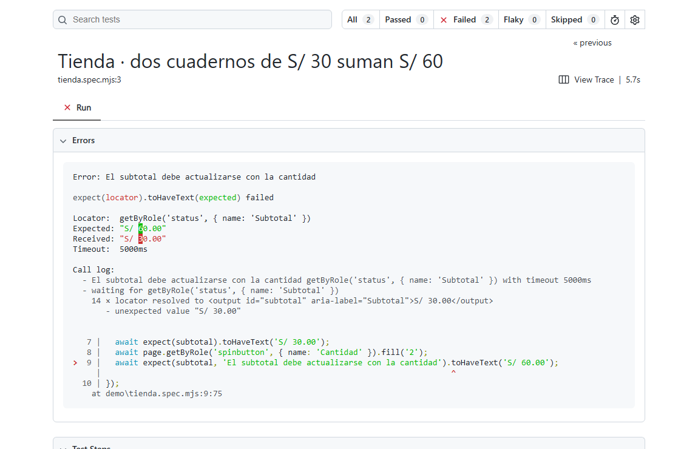

# Web Flow Check

Convierte un recorrido que probarías a mano en una prueba que puedes repetir. Comprueba que un enlace abre la página correcta, que un formulario responde como esperas o que el subtotal de un carrito coincide con la cantidad.

**AG CodeLab · v0.1.0** · Pruebas en Chromium, reporte HTML y una skill para agentes locales.



## Pruébalo en tu equipo

1. Descarga o clona este repositorio y abre una terminal en la carpeta que contiene `package.json`.
2. Con Node.js 22 o superior, ejecuta:

   ```sh
   npm ci
   npx playwright install chromium
   npm run demo
   ```

3. Ejecuta `npm run demo -- --broken`. Las **mismas dos pruebas** ahora deben fallar. El portafolio abre una ruta inexistente y el carrito muestra S/ 30.00 donde debería mostrar S/ 60.00. El código de salida distinto de cero es esperado.
4. Abre el reporte con `npm run report`. Haz clic en una prueba fallida para ver el error, los pasos y sus adjuntos. Detén el visor con Ctrl+C. El reporte corresponde a la ejecución más reciente.

Las demos usan el puerto local 4176. Si está ocupado, libera el puerto antes de correrlas. En Linux, Chromium puede requerir [dependencias del sistema](https://playwright.dev/docs/browsers#install-system-dependencies). Si PowerShell bloquea los scripts de npm, usa `npm.cmd` y `npx.cmd` en los comandos.

## Instala la skill en tu agente

En la carpeta descargada, ejecuta el comando de tu agente. Cada instalador copia los archivos del repositorio a su carpeta personal de skills.

| Agente | Comando | Cómo invocarla |
| --- | --- | --- |
| [Codex](https://learn.chatgpt.com/docs/build-skills) | `npm run install:skill -- codex` | `$web-flow-check` |
| [Claude Code](https://code.claude.com/docs/en/skills) | `npm run install:skill -- claude-code` | `/web-flow-check` |
| [Antigravity](https://antigravity.google/docs/skills) | `npm run install:skill -- antigravity` | `/web-flow-check` |

Si ya existe una instalación, consérvala o retírala antes de instalar otra versión. Abre una sesión local nueva si la skill todavía no aparece.

Si usas otro cliente compatible con [Agent Skills](https://agentskills.io/specification), ejecuta `npm run init -- RUTA_DE_SKILLS/web-flow-check` con la ruta que indique su documentación. El agente necesita acceso local a la terminal, a la carpeta del proyecto y al navegador.

Abre tu proyecto en el agente, arranca tu web local e invoca la skill con un pedido como este:

> En http://localhost:8000, comprueba que al intentar reservar una fecha pasada aparezca un error y que el formulario siga en el mismo paso. Deja la prueba para poder repetirla.

Si tu proyecto ya usa Playwright, la skill puede aprovecharlo. Para otros proyectos, prepara una carpeta de pruebas separada. Si la acción escribe datos o activa una integración, usa un entorno y una cuenta de prueba.

## Úsalo desde la terminal

Con tu web local en ejecución, guarda una copia del [ejemplo](examples/local-page.spec.mjs) como `checks/inicio.spec.mjs` y ajusta el encabezado esperado a tu página. Crea la carpeta `checks` si todavía no existe. Después ejecuta:

```sh
npm run check -- http://localhost:8000 inicio.spec.mjs
npm run report
```

Cambia la URL por la dirección exacta de tu web. El comando acepta `localhost`, `127.0.0.1` y `[::1]`, también con una subcarpeta como `http://localhost/mi-tienda/`. Omite el filtro de archivo para correr todas las pruebas en `checks/`. Si quieres un entorno separado para otro proyecto, ejecuta `npm run init -- RUTA_NUEVA`, entra en esa carpeta y corre `npm ci` antes de añadir tus pruebas.

## Qué se queda en tu equipo

El navegador prueba tu web local. Los archivos de prueba, las capturas y las trazas quedan en disco. La descarga inicial de dependencias requiere internet. Una vez instaladas, las pruebas de terminal se pueden volver a ejecutar sin conexión si la web también funciona sin ella. Si usas un agente para generar la prueba, sus requisitos de conexión y el tratamiento de los datos dependen de ese cliente y su configuración.

Un resultado aprobado corresponde a lo que la prueba comprobó. Revisa los reportes antes de compartirlos, ya que pueden contener datos de la sesión de prueba.

## English quick start

Run `npm ci`, `npx playwright install chromium`, then `npm run demo`. Try `npm run demo -- --broken` for two intentional failures and `npm run report` to inspect the evidence. Install the skill with `npm run install:skill -- codex` (or select `claude-code` or `antigravity`). For terminal-only use, adapt the [example test](examples/local-page.spec.mjs) under `checks/` and run `npm run check -- http://localhost:8000`.

[Licencia MIT](LICENSE)
